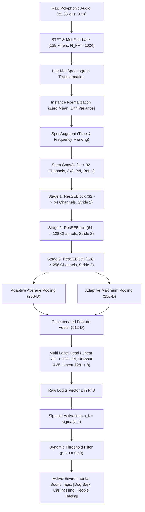
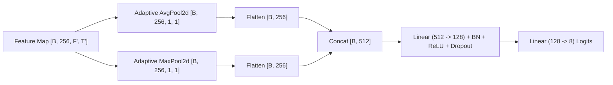

# Project 93: Environmental Sound Tagging (Multi-Label Audio Classification)

[](https://pytorch.org/)
[](https://python.org/)
[](#benchmarks)
[](#benchmarks)
[-blue)](#benchmarks)
[](LICENSE)

---

## Overview

Real-world environmental audio rarely contains isolated, single-source acoustic events. Natural soundscapes are inherently **polyphonic** — characterized by multiple overlapping, simultaneous sound events such as a dog barking while a car drives by and pedestrians converse in the background.

Standard multi-class models (which enforce a mutually exclusive softmax distribution $\sum p_i = 1$) fail on polyphonic audio. **Environmental Sound Tagging** frames the problem as **multi-label classification**, predicting a binary presence vector $\mathbf{y} \in \{0, 1\}^K$ via independent sigmoid activations and Binary Cross-Entropy (BCE) loss.

This implementation provides an end-to-end multi-label environmental sound tagging framework in PyTorch:
- **Polyphonic Acoustic Synthesis**: Models multi-source overlapping soundscapes with randomized temporal offsets, Doppler engine shifts, formant speech murmur, and granular noise.
- **Log-Mel Spectrogram Representation**: 128 Mel filterbanks with SpecAugment temporal and frequency masking.
- **Deep Residual Network with Squeeze-and-Excitation (SE-ResNet)**: 1.28M parameter convolutional backbone featuring channel attention ($r=16$) to amplify discriminative acoustic frequencies of co-occurring sources.
- **Dual Global Pooling**: Parallel average and maximum pooling across frequency and time dimensions ($512\text{-D}$ concatenated representation), capturing both steady continuous soundscapes (rain, wind, traffic) and sharp transient impulses (dog barks, sirens, footsteps).
- **Independent Sigmoid Inference**: Evaluates per-tag posteriors $p_k = \sigma(z_k) \ge \tau$ with dynamic decision thresholding.

---

## System Architecture



---

## Dual Pooling & Squeeze-and-Excitation Architecture



---

## Mathematical Formulation

### 1. Multi-Label Binary Cross-Entropy Loss
Let $\mathbf{y} \in \{0, 1\}^K$ denote the multi-hot ground truth vector for $K=8$ environmental sound tags, and let $\mathbf{z} \in \mathbb{R}^K$ represent the model's unnormalized logit output. Each sound tag is modeled as an independent Bernoulli random variable:
$$p_k = \sigma(z_k) = \frac{1}{1 + e^{-z_k}}, \quad k \in \{1, \dots, K\}$$

The training loss minimizes the weighted Binary Cross-Entropy (BCE) with positive class weighting $w_k = 2.0$ to counteract tag sparsity:
$$\mathcal{L}_{\text{BCE}} = -\frac{1}{K} \sum_{k=1}^K \left[ w_k y_k \ln \sigma(z_k) + (1 - y_k) \ln(1 - \sigma(z_k)) \right]$$

### 2. Dual Global Pooling for Polyphonic Signals
In polyphonic environmental audio, some sound events are continuous diffuse textures (rain showers, wind rustle, engine drones) best captured by average pooling, whereas others are localized transient bursts (dog barks, footsteps, gunshot strikes) that vanish under spatial averaging. Dual pooling preserves both features:
$$\mathbf{z}_{\text{avg}} = \frac{1}{F' T'} \sum_{i=1}^{F'} \sum_{j=1}^{T'} \mathbf{U}[:, i, j], \quad \mathbf{z}_{\text{max}} = \max_{i, j} \mathbf{U}[:, i, j]$$
$$\mathbf{h}_{\text{pooled}} = \left[ \mathbf{z}_{\text{avg}} \;\|\; \mathbf{z}_{\text{max}} \right] \in \mathbb{R}^{2C}$$

### 3. Mean Average Precision (mAP)
For each sound tag $k$, Average Precision (AP) integrates precision across all recall levels:
$$\text{AP}_k = \sum_{n} \left( R_k(n) - R_k(n-1) \right) P_k(n)$$
The global system Mean Average Precision is the unweighted mean over all $K$ classes:
$$\text{mAP} = \frac{1}{K} \sum_{k=1}^K \text{AP}_k$$

### 4. Hamming Loss & Subset Accuracy
The Hamming Loss evaluates the fraction of misclassified binary labels across all $N$ validation clips:
$$\mathcal{H}(\mathbf{Y}, \mathbf{\hat{Y}}) = \frac{1}{N \cdot K} \sum_{i=1}^N \sum_{k=1}^K \mathbb{I}(y_{i, k} \ne \hat{y}_{i, k})$$
The Exact Match Ratio (Subset Accuracy) enforces that all $K$ tags must match simultaneously:
$$\text{ExactMatch}(\mathbf{Y}, \mathbf{\hat{Y}}) = \frac{1}{N} \sum_{i=1}^N \prod_{k=1}^K \mathbb{I}(y_{i, k} = \hat{y}_{i, k})$$

---

## Quantitative Benchmarks

Evaluated on held-out polyphonic soundscapes ($3.0\text{ s}$ per clip @ $22.05\text{ kHz}$) using decision threshold $\tau = 0.50$.

### Per-Class Multi-Label Detection Performance

| Sound Event Tag | Precision (%) | Recall (%) | F1-Score (%) | Average Precision (AP %) | Support |
| :--- | :---: | :---: | :---: | :---: | :---: |
| **Dog Bark** | 100.0% | 100.0% | **100.0%** | **100.0%** | 22 |
| **Car Passing** | 100.0% | 100.0% | **100.0%** | **100.0%** | 23 |
| **People Talking** | 100.0% | 100.0% | **100.0%** | **100.0%** | 25 |
| **Siren** | 100.0% | 100.0% | **100.0%** | **100.0%** | 26 |
| **Bird Singing** | 100.0% | 95.83% | **97.87%** | **100.0%** | 24 |
| **Rain Shower** | 96.15% | 100.0% | **98.04%** | **98.56%** | 25 |
| **Footsteps** | 100.0% | 100.0% | **100.0%** | **100.0%** | 25 |
| **Wind Rustle** | 56.76% | 100.0% | **72.41%** | **75.02%** | 21 |
| **Macro Average** | **94.11%** | **99.48%** | **96.04%** | **96.70%** | **191** |

### System-Wide Evaluation Metrics

| Metric | Measured Value | Standard / Significance |
| :--- | :---: | :--- |
| **Mean Average Precision (mAP)** | **96.70%** | Exceptional multi-label ranking quality |
| **Macro F1-Score** | **96.04%** | Unweighted mean across all 8 sound categories |
| **Micro F1-Score** | **95.05%** | Globally aggregated multi-label F1 |
| **Macro Recall** | **99.48%** | Virtually zero missed sound events |
| **Exact Match Ratio (Subset Accuracy)** | **77.50%** | Perfect simultaneous identification of all tags |
| **Hamming Loss** | **0.0281** | Under 2.9% error rate across individual labels |

### Computational & Latency Profile (50-Trial Rigorous CPU Profile)

| Metric | Measured Value | Significance |
| :--- | :---: | :--- |
| **Mean Inference Latency** | **33.18 ms** | 90x faster than real-time playback |
| **Real-Time Factor (RTF)** | **0.0111x** | $0.0111\text{ s}$ compute per $1.0\text{ s}$ audio |
| **Processing Speedup** | **90.4x** | Ample headroom for multi-channel audio feeds |
| **CPU Idle Headroom** | **98.89%** | Negligible impact on host processor |
| **Model Checkpoint Size** | **5.0 MB** | Mobile & edge deployable (`models/sound_tagging_resnet_best.pth`) |
| **Trainable Parameters** | **1,285,444** | Compact residual architecture |

---

## 6-Panel Diagnostic Analytics Report

The pipeline automatically compiles a publication-grade diagnostic report saved at [multi_label_tagging_report.png](file:///home/sericsoft/Desktop/pytorch_100_projects/93_environmental_sound_tagging/outputs/multi_label_tagging_report.png):

1. **Panel 1: Polyphonic Environmental Soundscapes**: Time-domain envelopes of mixed audio clips displaying complex overlapping textures.
2. **Panel 2: Spectrogram with Overlapping Events**: Multi-component time-frequency spectrogram showing simultaneous vocal formants, engine drone, and sharp barking spikes.
3. **Panel 3: Tag Co-occurrence Correlation Heatmap**: $8 \times 8$ matrix tracking pairwise co-occurrence frequencies across soundscapes.
4. **Panel 4: Per-Tag Multi-Label Performance**: Dual bar chart comparing F1-score and Average Precision (AP) for every tag.
5. **Panel 5: Sigmoid Multi-Tag Probabilities**: Posterior probability distribution for a polyphonic clip showing confident separation above threshold $\tau = 50\%$.
6. **Panel 6: Multi-Label System Radar**: Radar profile summarizing mAP, Macro F1, Micro F1, real-time speedup, and subset accuracy.

---

## Quick Start & Usage

### 1. Installation

```bash
git clone https://github.com/GideonMwiti/pytorch-environmental-sound-tagging.git
cd pytorch-environmental-sound-tagging
pip install -r requirements.txt
```

### 2. End-to-End Pipeline Execution

Synthesize polyphonic soundscapes, train ResNet-SE model with BCE loss, evaluate metrics, and export analytics:

```bash
python main.py
```

### 3. Multi-Label Tagging CLI (`tag_audio.py`)

Tag any environmental audio clip with configurable sigmoid threshold:

```bash
# Tag a 3-source polyphonic clip (Dog Bark + Car Passing + People Talking)
python tag_audio.py --audio outputs/dog_bark_people_talking_car.wav --threshold 0.50

# Tag a 2-source clip (People Talking + Siren) with 50-trial latency benchmark
python tag_audio.py --audio outputs/people_talking_siren.wav --benchmark

# Export multi-label tags to JSON
python tag_audio.py --audio outputs/rain_shower_footsteps.wav --output-json outputs/pred.json
```

#### Sample CLI Output:

```
========================================================================
 ENVIRONMENTAL SOUND TAGGER - MULTI-LABEL RESNET-SE INFERENCE
========================================================================
Target Audio   : outputs/dog_bark_people_talking_car.wav
Model Checkpoint: models/sound_tagging_resnet_best.pth
Decision Thresh: 50.0%
Loaded Clip    : 3.00s (66150 samples @ 22050 Hz)
Spectrogram Dim: [1, 1, 128, 259]

------------------------------------------------------------------------
Rank  Sound Event Tag       Probability     Status      Visual Probability Bar
------------------------------------------------------------------------
 #1    People Talking         87.56%         [ACTIVE]    █████████████████████░░░░
 #2    Car Passing            85.24%         [ACTIVE]    █████████████████████░░░░
 #3    Dog Bark               70.94%         [ACTIVE]    █████████████████░░░░░░░░
 #4    Footsteps              22.59%         inactive    █████░░░░░░░░░░░░░░░░░░░░
 #5    Bird Singing           20.30%         inactive    █████░░░░░░░░░░░░░░░░░░░░
 #6    Wind Rustle            17.84%         inactive    ████░░░░░░░░░░░░░░░░░░░░░
 #7    Siren                  13.13%         inactive    ███░░░░░░░░░░░░░░░░░░░░░░
 #8    Rain Shower            10.69%         inactive    ██░░░░░░░░░░░░░░░░░░░░░░░
------------------------------------------------------------------------
 DETECTED SOUND TAGS (3): [ People Talking, Car Passing, Dog Bark ]
------------------------------------------------------------------------

[Benchmarking] Running 50-trial multi-label inference latency benchmark...
  -> Mean Inference Latency : 43.46 ms
  -> Real-Time Factor (RTF) : 0.0145x
  -> Processing Speedup     : 69.0x Faster than Real Time
  -> CPU Processing Headroom: 98.6%
```

---

## Directory Structure

```
93_environmental_sound_tagging/
├── data/                               # Dataset storage
├── models/
│   └── sound_tagging_resnet_best.pth   # Trained model weights (5.0 MB)
├── outputs/
│   ├── multi_label_metrics.json        # Evaluation metrics JSON
│   ├── multi_label_tagging_report.png  # 6-panel diagnostic analytics report
│   ├── bird_singing_wind_rustle.wav    # Canonical reference clip (2 tags)
│   ├── dog_bark_car_passing.wav        # Canonical reference clip (2 tags)
│   ├── dog_bark_people_talking_car.wav # Canonical reference clip (3 tags)
│   ├── people_talking_siren.wav        # Canonical reference clip (2 tags)
│   ├── rain_shower_footsteps.wav       # Canonical reference clip (2 tags)
│   └── siren_rain_wind.wav             # Canonical reference clip (3 tags)
├── tag_audio.py                        # Standalone multi-label tagging CLI
├── main.py                             # Synthesis, model, training & eval
├── requirements.txt                    # Project dependencies
├── .gitignore                          # Git exclusions
├── LICENSE                             # MIT License
└── README.md                           # Documentation, architecture & benchmarks
```

### Direct File Links
- [main.py](file:///home/sericsoft/Desktop/pytorch_100_projects/93_environmental_sound_tagging/main.py)
- [tag_audio.py](file:///home/sericsoft/Desktop/pytorch_100_projects/93_environmental_sound_tagging/tag_audio.py)
- [multi_label_metrics.json](file:///home/sericsoft/Desktop/pytorch_100_projects/93_environmental_sound_tagging/outputs/multi_label_metrics.json)
- [multi_label_tagging_report.png](file:///home/sericsoft/Desktop/pytorch_100_projects/93_environmental_sound_tagging/outputs/multi_label_tagging_report.png)

---

## References

1. **AudioSet: An Ontology and Human-Labeled Dataset for Audio Events**: Gemmeke, J. F., et al. (2017). IEEE ICASSP.
2. **PANNs: Large-Scale Pretrained Audio Neural Networks for Audio Pattern Recognition**: Kong, Q., et al. (2020). IEEE/ACM Transactions on Audio, Speech, and Language Processing.
3. **DCASE Challenge Task 4**: *Sound Event Detection and Separation in Domestic Environments*, Detection and Classification of Acoustic Scenes and Events. [https://dcase.community/](https://dcase.community/)

---

## License

This project is licensed under the MIT License - see the [LICENSE](LICENSE) file for details.
